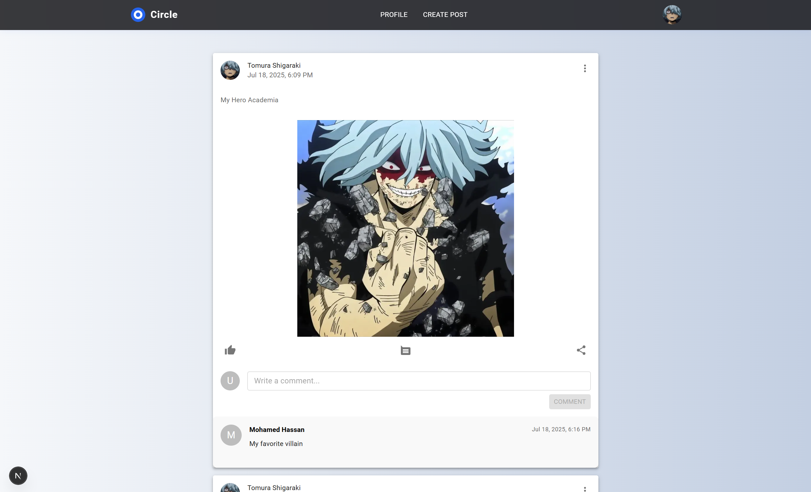
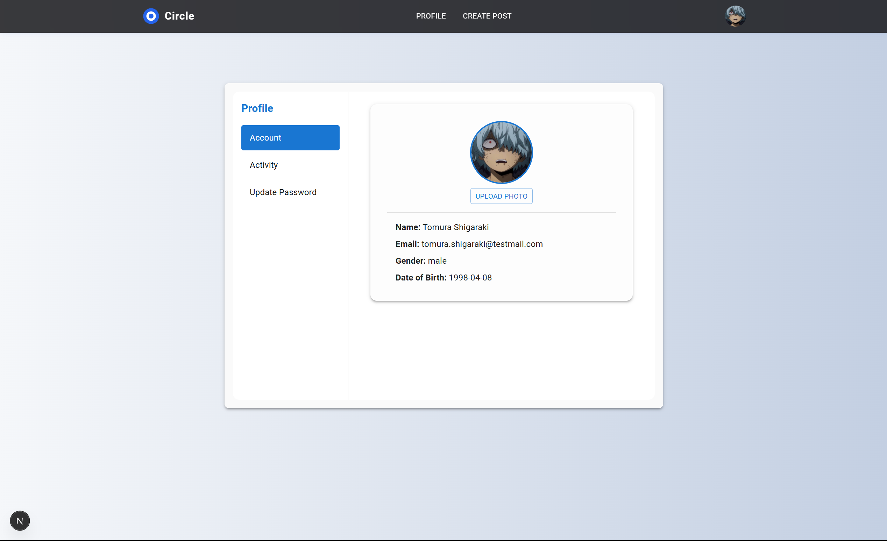

# Circle

A modern social app built with **Next.js** and **MUI**. This project demonstrates best practices in **Next.js**, **Redux**, **MUI**, and modular component design.

| Home | Account |
|------|----------------|
|  |  |

## Features
- User registration and authentication
- Create, view, and manage posts and comments
- User profile with avatar upload and password change
- Responsive UI with reusable Material-UI components
- State management with Redux Toolkit

## Tech Stack
- **Framework:** Next.js
- **Language:** TypeScript
- **UI Library:** [Material-UI (MUI)](https://mui.com/) for modern, accessible, and customizable components

#
[Live Demo](https://circle-app-puce.vercel.app/)

